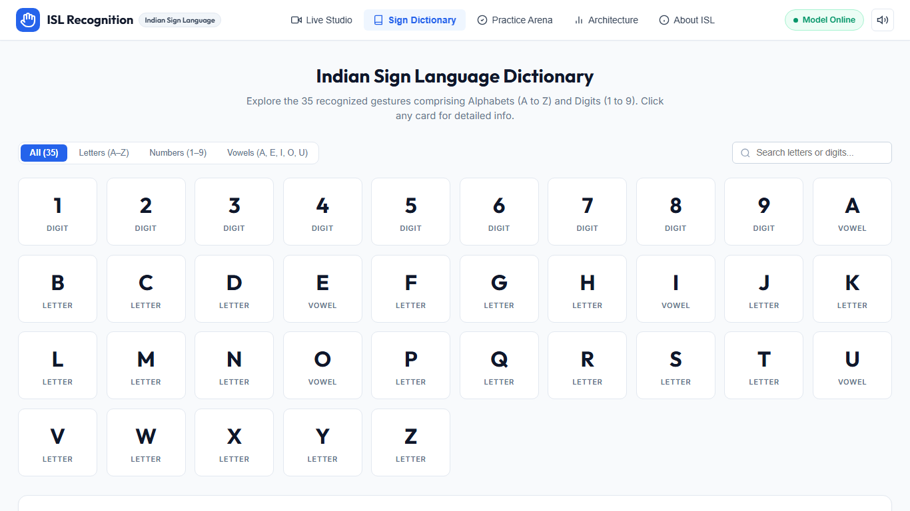
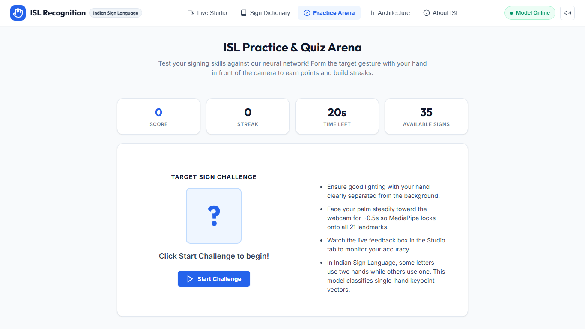
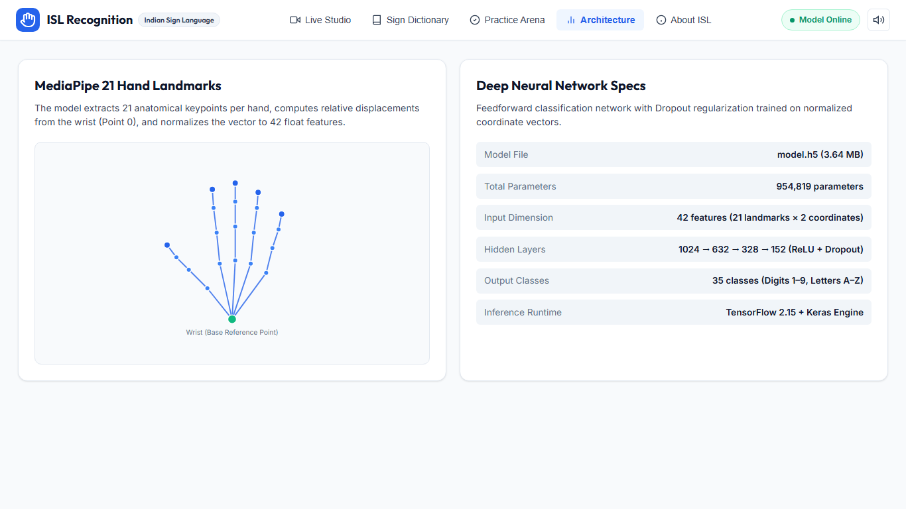
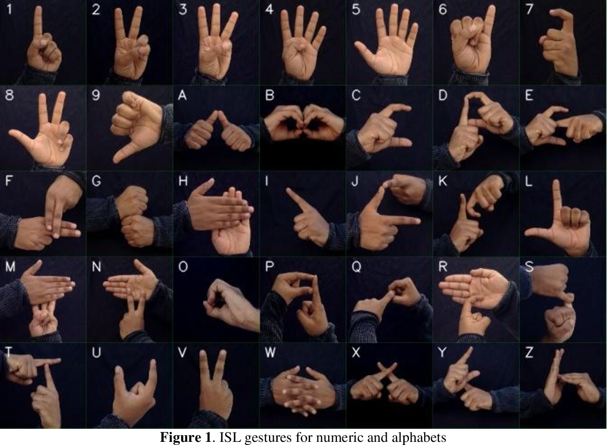

# <p align="center">🤟 Indian Sign Language (ISL) Recognition AI & Web Studio</p>

<p align="center">
  <em>Bridging communication gaps across India with edge-accelerated deep learning, 21 3D hand keypoints, real-time sentence synthesis, and a gamified learning studio.</em>
</p>

<p align="center">
  <a href="#-project-showcase"></a>
  <a href="https://www.python.org/"></a>
  <a href="https://www.tensorflow.org/"></a>
  <a href="https://mediapipe.dev/"></a>
  <a href="https://opencv.org/"></a>
  <a href="https://flask.palletsprojects.com/"></a>
  <a href="#-license"></a>
</p>

<p align="center">
  <a href="#-quick-start"><b>🚀 Quick Start</b></a> •
  <a href="#-project-showcase"><b>📸 Showcase</b></a> •
  <a href="#-features--superpowers"><b>✨ Features</b></a> •
  <a href="#-system-architecture"><b>🧠 Architecture</b></a> •
  <a href="#-official-isl-gesture-matrix"><b>🤟 Sign Matrix</b></a> •
  <a href="#-rest-api"><b>🔌 API</b></a> •
  <a href="#-roadmap"><b>🗺️ Roadmap</b></a>
</p>

---

<p align="center">
  
</p>

---

## 📸 Project Showcase

Experience the multimodal suite designed for both real-time practical translation and interactive sign language learning:

| 🎥 Live Gesture Tracker & Sentence Builder | 📖 Interactive Sign Dictionary |
|:---:|:---:|
|  |  |
| **Real-time 21-point tracking, word buffer & Web Speech TTS** | **Searchable 35 gestures with dynamic category filtering** |

| 🎮 Practice Arena & Gamified Challenges | 🔬 Neural Topology & Feature Engineering |
|:---:|:---:|
|  |  |
| **Gamified signing quizzes with countdowns, scores & streaks** | **MediaPipe 21 Hand Landmarks & 5-Layer Deep Neural Net** |

---

## ✨ Features & Superpowers

```
  ┌────────────────────────────────────────────────────────────────────────┐
  │  ⚡ 21 Keypoints 3D Tracking  │  🧠 35-Class Deep Neural Network        │
  │  🗣️ Multimodal TTS Synthesis  │  🎮 Gamified Quiz Arena & Streaks       │
  │  📚 Searchable ISL Dictionary │  🎥 Dual-Engine Client/Server Vision    │
  └────────────────────────────────────────────────────────────────────────┘
```

- 🎯 **Real-Time 3D Keypoint Tracking**: Extracts 21 anatomical landmarks per hand with low-latency MediaPipe pipelines and glowing neon visualization overlays.
- 📐 **Scale & Translation Invariance**: Pre-processes hand coordinates relative to the wrist origin and normalizes by bounding span, making predictions robust across distances and camera angles.
- 🧠 **High-Confidence Classification**: Deep Feedforward Neural Network recognizing **35 distinct classes** (Digits `1–9` & Alphabets `A–Z`) with full top-5 probability distribution.
- 📝 **Smart Sentence Builder**: Hold gestures to auto-append characters, create spaces, backspace edits, and copy full sentences with 1 click.
- 🔊 **Voice Synthesis (TTS)**: Built-in Web Speech API converts recognized sign sentences into clear spoken English audio on demand.
- 🎮 **Gamified Practice Arena**: Dynamic flashcard quizzes with countdown timers, real-time accuracy scoring, and winning streaks to master ISL.
- 📖 **Interactive Sign Catalog**: Instant searchable dictionary categorized into *Numbers*, *Alphabets*, and *Vowels* with posture reference guidance.
- ⚡ **Dual Video Pipelines**:
  - **Browser Mode**: Ultra-smooth client-side video processing via MediaPipe JavaScript SDK.
  - **OpenCV Backend Mode**: Low-overhead server-side MJPEG video stream with direct OpenCV rendering.

---

## 🧠 System Architecture

```mermaid
flowchart LR
    A[📹 Video Input Feed] --> B[🖐️ MediaPipe Hand Pipeline]
    B -->|21 3D Landmarks| C[📐 Wrist-Relative Normalizer]
    C -->|42 Normalized Features| D[🧠 Deep Neural Network]
    
    subgraph Model [model.h5 Deep Neural Classifier]
        D --> D1[Dense 1024 + ReLU + Dropout]
        D1 --> D2[Dense 632 + ReLU + Dropout]
        D2 --> D3[Dense 328 + ReLU + Dropout]
        D3 --> D4[Dense 152 + ReLU + Dropout]
        D4 --> D5[Dense 35 + Softmax]
    end

    D5 --> E{Confidence Filter >= 65%}
    E -->|High Confidence| F[🔤 Real-Time Sign Classification]
    E -->|Low Confidence| G[⏳ Waiting / Stabilizing]
    
    F --> H[📝 Sentence Accumulator]
    H --> I[🔊 Speech Synthesis TTS]
```



### 🔬 Network Specification
- **Input Dimension**: `42` (21 hand coordinates $(x_i - x_0, y_i - y_0)$ normalized by $\max(|V|)$)
- **Hidden Layers**: `1024` &rarr; `632` &rarr; `328` &rarr; `152` units with ReLU activations and 20% Dropout
- **Output Layer**: `35` units with Softmax activation
- **Total Parameters**: `954,819` (~3.64 MB disk footprint)
- **Inference Latency**: `< 15ms` per frame on modern CPU

---

## 🤟 Official ISL Gesture Matrix

The model recognizes **35 standardized gestures** according to official Indian Sign Language guidelines:

<p align="center">
  
  <br />
  <em>Official Indian Sign Language (ISL) Standard Chart for Numerics (1–9) and Alphabets (A–Z)</em>
</p>

### 📋 Supported Sign Categories

| Category | Signs Supported | Description |
|:---|:---|:---|
| **🔢 Numeric Digits** | `1`, `2`, `3`, `4`, `5`, `6`, `7`, `8`, `9` | Single-hand quantitative representations |
| **🔤 Alphabets (A–Z)** | `A`, `B`, `C`, `D`, `E`, `F`, `G`, `H`, `I`, `J`, `K`, `L`, `M`, `N`, `O`, `P`, `Q`, `R`, `S`, `T`, `U`, `V`, `W`, `X`, `Y`, `Z` | Complete English alphabet vocabulary in ISL posture |
| **⭐ Vowels Highlight** | `A`, `E`, `I`, `O`, `U` | Key vocalic anchors filtered in the Sign Dictionary |

---

## 🚀 Quick Start

### Option A: 1-Click Launchers (Windows)

| Launcher Script | Description |
|:---|:---|
| [`run_website.bat`](file:///e:/Indian-Sign-Language-Recognition/run_website.bat) | 🌐 Launches Flask Web Studio & opens browser at `http://localhost:5000` |
| [`run.bat`](file:///e:/Indian-Sign-Language-Recognition/run.bat) | 💻 Launches standalone high-speed OpenCV desktop HUD window |

---

### Option B: Terminal Setup

#### 1. Clone & Enter the Repository
```bash
git clone https://github.com/swapnil3104/Indian-Sign-Language-Recognition.git
cd Indian-Sign-Language-Recognition
```

#### 2. Create and Activate Virtual Environment
```bash
# Using Conda
conda create -n isl python=3.10 -y
conda activate isl

# OR using Python venv
python -m venv venv
# Windows:
.\venv\Scripts\activate
# Linux/macOS:
source venv/bin/activate
```

#### 3. Install Dependencies
```bash
pip install -r requirements.txt
```

#### 4. Launch the Application
```bash
# Start Web Studio
python app.py

# OR Start Desktop OpenCV Detector
python isl_detection.py
```
Visit **[http://localhost:5000](http://localhost:5000)** in your browser!

---

## 🔌 REST API Endpoints

Integrate ISL Recognition directly into your own applications or external clients:

### `POST /predict`
Send normalized 21-landmark coordinates to receive class predictions.

**Request Payload:**
```json
{
  "landmarks": [
    [240, 320], [245, 310], [250, 290], ...
  ]
}
```

**Response Payload:**
```json
{
  "prediction": "A",
  "confidence": 0.9842,
  "top_5": [
    {"sign": "A", "probability": 0.9842},
    {"sign": "E", "probability": 0.0091},
    {"sign": "S", "probability": 0.0035},
    {"sign": "T", "probability": 0.0018},
    {"sign": "M", "probability": 0.0007}
  ]
}
```

### `GET /video_feed`
Streams the live OpenCV camera feed with landmark skeleton overlay as an MJPEG stream.

---

## 📁 Repository Structure

```
Indian-Sign-Language-Recognition/
├── 📄 app.py                  # Flask web backend & REST inference server
├── 📄 isl_detection.py        # Standalone OpenCV desktop HUD application
├── 🧠 model.h5                # Trained 5-layer Deep Neural Network (954K params)
├── 🚀 run_website.bat         # 1-click Windows launcher for Web Studio
├── 🚀 run.bat                 # 1-click Windows launcher for Desktop OpenCV
├── 📦 requirements.txt        # Python dependency manifest
├── 📁 assets/                 # UI screenshots & showcase assets
│   ├── Screenshot ...png     # Live studio demo capture
│   ├── sign_dictionary.png    # Dictionary view
│   ├── practice_arena.png     # Gamified arena view
│   └── architecture.png       # Topology diagram
├── 📁 images/                 # Reference gesture charts
│   └── allGestures.png        # Official ISL postures for A-Z & 1-9
├── 📁 templates/              # HTML5 Web UI
│   └── index.html             # Full-featured responsive Web Studio
└── 📁 static/                 # Styles, scripts, and media
    ├── css/style.css          # Glassmorphic dark/light UI design system
    └── js/main.js             # MediaPipe camera loop, TTS & quiz logic
```

---

## 🗺️ Roadmap & Future Horizons

- [x] Real-time 21-keypoint extraction with MediaPipe Hands
- [x] Normalized 35-class Deep Neural Network inference
- [x] Modern Glassmorphism Web Studio with Speech Synthesis (TTS)
- [x] Gamified Practice & Quiz Arena with streak scoring
- [ ] **Two-Hand Gesture Support**: Dual-hand tracking for advanced Indian Sign Language words & phrases
- [ ] **Temporal Sequence Modeling**: Transformer / Bi-LSTM integration for continuous sentence flow
- [ ] **Mobile Progressive Web App (PWA)**: Offline-first mobile camera translation
- [ ] **Regional Language Audio Output**: Hindi, Marathi, Tamil, Bengali, and Telugu speech synthesis

---

## 🤝 Contributing

Contributions are what make the open-source community an inspiring place to learn, inspire, and create:

1. **Fork** the repository
2. **Create** your feature branch (`git checkout -b feature/AmazingFeature`)
3. **Commit** your changes (`git commit -m 'Add some AmazingFeature'`)
4. **Push** to the branch (`git push origin feature/AmazingFeature`)
5. **Open** a Pull Request

---

## 📄 License

Distributed under the **MIT License**. See `LICENSE` for more information.

---

<p align="center">
  Made with ❤️ for accessibility and inclusive communication across India 🇮🇳
</p>

<p align="center">
  <a href="#-indian-sign-language-isl-recognition-ai--web-studio">⬆️ Back to Top</a>
</p>

